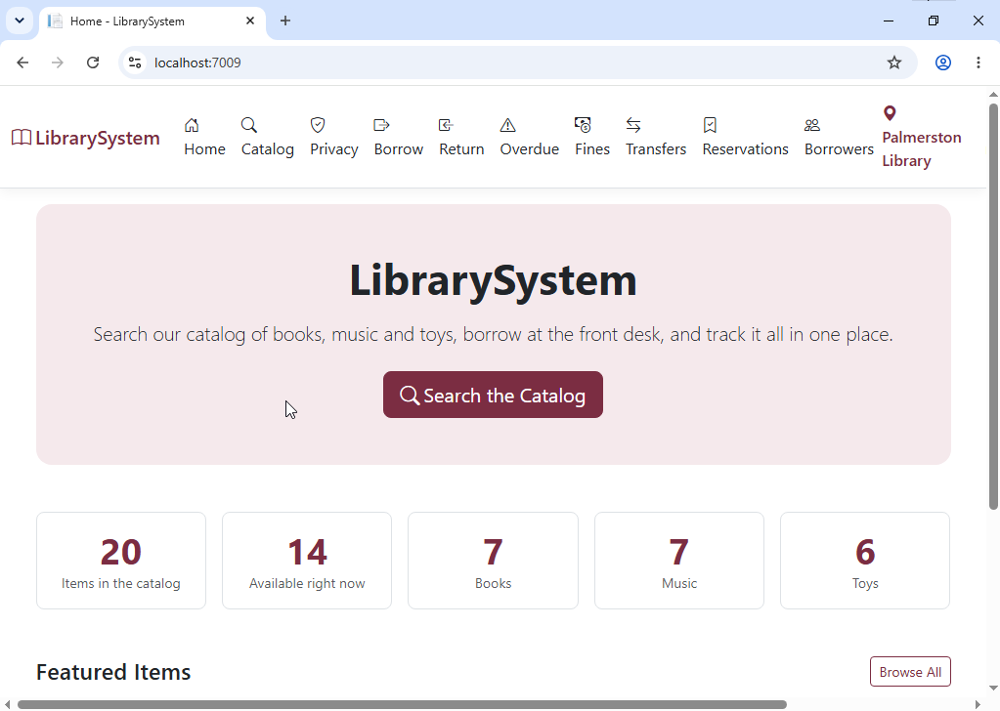
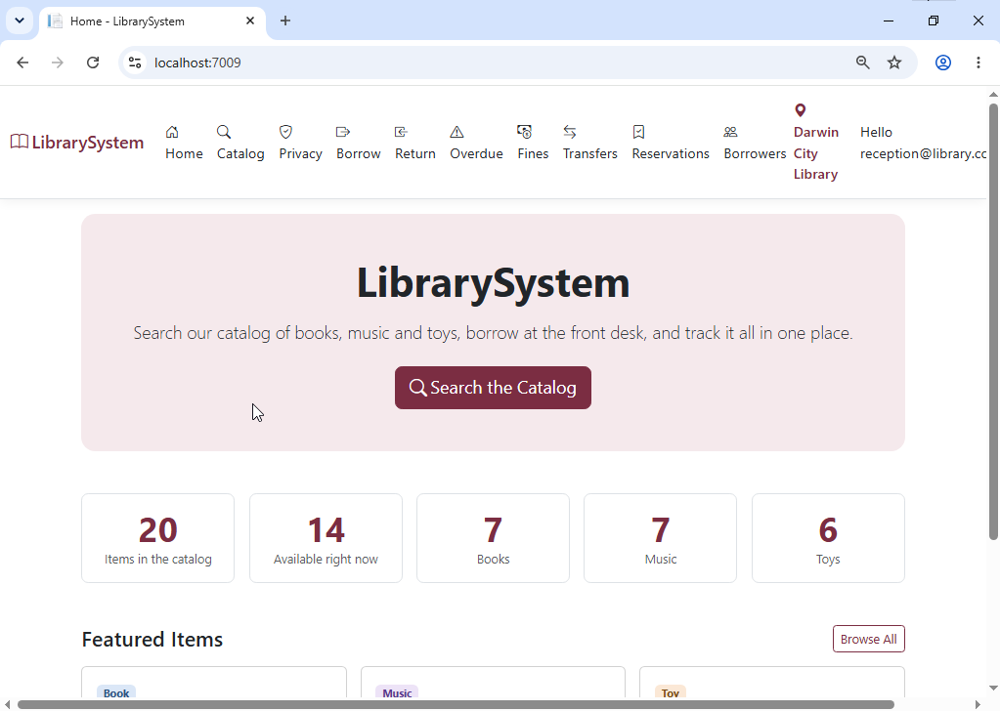

# Installation and Running Instructions

*HIT339 Distributed Development — Library Management System. Binay Siwakoti (S387596). Repository: [github.com/Binay216/LibrarySystem](https://github.com/Binay216/LibrarySystem)*

## About this manual

Following these steps on a clean Windows machine produces a working library system for any one of the three branch locations, in about 15 minutes.

|            |                                                                                       |
|------------|---------------------------------------------------------------------------------------|
| Project    | Library Management System — Group Project Management and Horizontal Feature Expansion |
| Unit       | HIT339 Distributed Development, Charles Darwin University                             |
| Author     | Binay Siwakoti (S387596), sole group member                                           |
| Repository | https://github.com/Binay216/LibrarySystem                                             |

**One set of instructions for every branch.** Casuarina, Palmerston and Darwin City all follow exactly the same steps. The only difference is a single configuration value chosen in Step 2. There is no separate codebase or git branch per location.

**Written for** someone who has never seen this project and has no database experience. No commands need to be typed beyond the one `git clone`.

> **Verified on a clean virtual machine.** These instructions were followed end to end on a fresh Windows Server 2019 virtual machine running Visual Studio 2026 Community, starting from nothing but the operating system and a fresh clone of the repository, and then repeated for each branch location: Casuarina, Palmerston and Darwin City. The full test record, including the issues found and how each was handled, is in the *Virtual machine test* section.

## Prerequisites

Visual Studio with the ASP.NET workload installs everything except Git and a browser.

| Requirement                                                                 | Notes                                                                                                              |
|-----------------------------------------------------------------------------|--------------------------------------------------------------------------------------------------------------------|
| Windows with administrator rights                                           | Needed to install the tools below                                                                                  |
| Visual Studio 2022 or later, any edition (the free Community edition works) | Must include the **ASP.NET and web development** workload                                                          |
| .NET 10 SDK                                                                 | Installed by the workload. Check with `dotnet --version`; expect `10.x`                                            |
| SQL Server LocalDB                                                          | Installed by the workload. A local database engine with no server, service or network setup                        |
| Git                                                                         | Or GitHub Desktop, or Visual Studio's built-in Git support                                                         |
| A modern browser                                                            | Chrome, Edge or Firefox. **Internet Explorer is not supported** and is still the default browser on Windows Server |

**Adding the workload to an existing Visual Studio:**

1.  Open the **Visual Studio Installer**.

2.  Find your installation and click **Modify**.

3.  Tick **ASP.NET and web development**.

4.  Click **Modify** again and wait for it to finish.

## Step 1 — Download the project from the git repository

Clone the repository to any folder on the machine. Use whichever of the three methods below you are comfortable with; they produce the same result.

**Option A — command line** (Command Prompt, PowerShell or Git Bash):

    git clone https://github.com/Binay216/LibrarySystem.git

**Option B — Visual Studio:**

1.  Open Visual Studio and choose **Clone a repository** on the start screen.

2.  Paste `https://github.com/Binay216/LibrarySystem.git` into **Repository location**.

3.  Choose a local path, for example `C:\Projects\LibrarySystem`, and click **Clone**.

**Option C — GitHub Desktop:** **File → Clone repository → URL**, paste the same address, choose a path and click **Clone**.

The repository uses a single main line of code for all three branch locations. Do not look for a git branch named after a library; there isn't one, by design.

## Step 2 — Choose the branch location

The branch an installation represents is set by one value in `appsettings.json`. The default is Casuarina; skip this step if that is the branch you want.

1.  In the cloned folder, open `appsettings.json` in Notepad or Visual Studio.

2.  Find this section:

<!-- -->

    "Library": {"BranchCode": "CAS"}

3.  Change `CAS` to the code for your branch, then save the file.

| Branch location     | Code            |
|---------------------|-----------------|
| Casuarina Library   | `CAS` (default) |
| Palmerston Library  | `PAL`           |
| Darwin City Library | `DRW`           |

The code is checked against the seeded branches when the application starts. A mistyped code stops the application straight away with a message listing the valid codes, rather than letting it run in a confusing state.

**What the branch setting changes:** the branch name shown in the header, which items Reception can borrow and return, which transfers appear in the transfer queue, the overdue list, and the branch the kiosk identifies itself as.

**What stays the same at every branch:** Manager dashboards and reports (they show all branches and have their own branch filter), and the public catalogue and API (they always search every branch).

If you change the code later, stop the application and start it again. A running application does not pick up configuration changes.

## Step 3 — Open the solution and run

Pressing F5 is the whole setup. The database is created, migrated and filled with sample data automatically on the first run.

1.  In the cloned folder, double-click `LibrarySystem.slnx`. This is the newer solution file format, which current Visual Studio opens natively. Open the solution file, not the folder; opening the folder gives a file view with no run button.

2.  Wait for NuGet package restore to finish. Progress shows in the status bar at the bottom; it only takes time on the first run.

3.  Press **F5** (or the green **Run** button).

On the first run the application automatically:

- creates the LocalDB database,

- applies every Entity Framework migration,

- seeds three branches, three staff accounts, five borrowers and twenty items, with a realistic mix of loans, fines, reservations and transfers.

There are no Package Manager Console commands, no `Update-Database`, and no SQL scripts to run by hand. A browser window opens on the home page when it is ready.

The site runs at `https://localhost:7009`, or `http://localhost:5105` if you choose the **http** launch profile.

## Step 4 — Confirm it worked

Sign in as the Manager and check the dashboard shows populated charts. That one check proves the database was created, migrated and seeded correctly.

1.  Click **Login** in the top right.

2.  Sign in with `manager@library.com` / `Manager@123`.

3.  Open the Manager dashboard and confirm the charts and figures show data, not zeros.

4.  Check the header shows the branch name you chose in Step 2.

The public catalogue needs no login; it is reachable from the home page as soon as the application starts.

**Seeded staff accounts:**

| Role      | Email                   | Password        | Can do                                                |
|-----------|-------------------------|-----------------|-------------------------------------------------------|
| Admin     | `admin@library.com`     | `Admin@123`     | Manage items, bulk CSV import, API documentation      |
| Reception | `reception@library.com` | `Reception@123` | Borrow and return, borrowers, reservations, transfers |
| Manager   | `manager@library.com`   | `Manager@123`   | Dashboards, notifications, reports and exports        |

These are demonstration credentials, documented deliberately so the system can be assessed straight away.

## Quick reference — setting up each branch location

Every branch runs the same four steps; only the value in Step 2 differs.

| Step                                    | Casuarina                  | Palmerston              | Darwin City              |
|-----------------------------------------|----------------------------|-------------------------|--------------------------|
| 1\. Clone the repository                | Same                       | Same                    | Same                     |
| 2\. Set `Library:BranchCode`            | `CAS` (default, no change) | `PAL`                   | `DRW`                    |
| 3\. Open `LibrarySystem.slnx`, press F5 | Same                       | Same                    | Same                     |
| 4\. Log in as Manager and check         | Header shows Casuarina     | Header shows Palmerston | Header shows Darwin City |

## Virtual machine test

The brief asks for these instructions to be tested on a virtual machine. They were followed exactly as written on a clean virtual machine, and the application built, created its database, seeded its sample data and ran. Four issues surfaced along the way: one was fixed in the code, and three are now covered in this manual. The branch setting was then changed to Palmerston, and then to Darwin City, and the same instructions were run again each time.

**Test environment**

|                       |                                                                                                                    |
|-----------------------|--------------------------------------------------------------------------------------------------------------------|
| Machine               | Fresh Windows Server 2019 virtual machine                                                                          |
| Software installed    | Visual Studio 2026 Community with the ASP.NET and web development workload                                         |
| Starting point        | The operating system only, then a fresh clone of the repository                                                    |
| Dates                 | 14–15 October 2026 (clean install); 16 October 2026 (branch changes)                                               |
| Instructions followed | This manual, as written, from Prerequisites to Step 4, once for each branch: Casuarina, Palmerston and Darwin City |

**Results by step**

| Step                                | Result                        | Notes                                                                                                                                                                                                                                      |
|-------------------------------------|-------------------------------|--------------------------------------------------------------------------------------------------------------------------------------------------------------------------------------------------------------------------------------------|
| Prerequisites                       | Passed                        | Workload installed through the Visual Studio Installer                                                                                                                                                                                     |
| Step 1 — Download the project       | Passed                        | Fresh clone from GitHub                                                                                                                                                                                                                    |
| Step 2 — Choose the branch location | Passed for all three branches | First run as Casuarina, the default. `BranchCode` was then changed to `PAL` and the application restarted; the header showed Palmerston Library (Figure 1). It was then changed to `DRW`; the header showed Darwin City Library (Figure 2) |
| Step 3 — Open the solution and run  | Passed after two fixes        | A package vulnerability warning and an antivirus false positive, both described below                                                                                                                                                      |
| Step 4 — Confirm it worked          | Passed                        | Database created, migrated and seeded automatically with no manual commands; the site then ran normally in a modern browser                                                                                                                |

*Figure 1 — The application running on the virtual machine after the branch was changed to PAL, with Palmerston Library in the header*

*Figure 2 — The application running on the virtual machine after the branch was changed to DRW, signed in as Reception, with Darwin City Library in the header*

**Issues found and how each was handled**

| Issue                            | What happened                                                                                                                                                  | How it was handled                                                                                                                                                                                                    |
|----------------------------------|----------------------------------------------------------------------------------------------------------------------------------------------------------------|-----------------------------------------------------------------------------------------------------------------------------------------------------------------------------------------------------------------------|
| Vulnerable package               | A high-severity vulnerability warning on System.Security.Cryptography.Pkcs 9.0.11, pulled in indirectly through the SQL Server provider                        | Fixed in the code. The patched version 10.0.13 is now referenced directly in the project, so the warning no longer appears. The warning was fixed rather than suppressed                                              |
| Antivirus false positive         | Windows Defender quarantined QuestPdfSkia.dll, QuestPDF’s graphics library used for PDF reports, and the build failed with a misleading “file not found” error | Not a code problem. The fix, a folder exclusion and restoring the file, is in Troubleshooting                                                                                                                         |
| Default browser                  | The site opened in Internet Explorer, the Windows Server default, which does not render the interface                                                          | Documented under Prerequisites: use Edge, Chrome or Firefox                                                                                                                                                           |
| Visual Studio Hot Reload message | After the branch change, Visual Studio logged an internal Hot Reload error (“No pending webSession for web server”)                                            | A Visual Studio tooling message, not an application error. It was marked recoverable and the site started normally. If F5 ever fails to open the site, Ctrl+F5 runs it without Hot Reload; this is in Troubleshooting |

**Outcome.** With those points addressed, a person following this manual on a clean Windows machine ends up with a working system and needs no steps beyond the ones written here. Changing the branch needed nothing beyond the one setting in Step 2, which is what the brief asks for: every location follows the same instructions.

## Troubleshooting

| Problem                                                                                                       | Cause                                                                                                                                 | Fix                                                                                                                                                                                                                                                 |
|---------------------------------------------------------------------------------------------------------------|---------------------------------------------------------------------------------------------------------------------------------------|-----------------------------------------------------------------------------------------------------------------------------------------------------------------------------------------------------------------------------------------------------|
| Build fails naming `QuestPdfSkia.dll` and "a virus or potentially unwanted software" (`MSB3021` or `MSB3030`) | Windows Defender false positive on QuestPDF's graphics library, used for PDF reports. *Found during the virtual machine test.*        | Add `%userprofile%\.nuget\packages` as a folder exclusion under **Windows Security → Virus & threat protection → Manage settings → Exclusions**. Restore the file from **Protection history**, or run `dotnet nuget locals all --clear` and rebuild |
| Pages look broken or unstyled                                                                                 | Opened in Internet Explorer, the Windows Server default                                                                               | Copy the address into Edge, Chrome or Firefox                                                                                                                                                                                                       |
| Seed data changes are not appearing                                                                           | Seeding only runs when the database is first created                                                                                  | Delete the database and press F5 again (steps below)                                                                                                                                                                                                |
| LocalDB connection errors                                                                                     | LocalDB missing or stopped                                                                                                            | Run `sqllocaldb info`; if unrecognised, add the ASP.NET workload. If stopped, run `sqllocaldb start mssqllocaldb`                                                                                                                                   |
| "Unknown branch code" at startup                                                                              | `Library:BranchCode` does not match a branch                                                                                          | Use `CAS`, `PAL` or `DRW`; the message lists them                                                                                                                                                                                                   |
| Certificate warning over HTTPS                                                                                | Development certificate not trusted                                                                                                   | Run `dotnet dev-certs https --trust`, or pick the **http** launch profile                                                                                                                                                                           |
| Port already in use                                                                                           | Another copy is running on port 5105 or 7009                                                                                          | Close it, or change the ports in `Properties/launchSettings.json`                                                                                                                                                                                   |
| Visual Studio logs “No pending webSession for web server”, or the site does not open after F5                 | An internal Visual Studio Hot Reload glitch, not an application error. Seen once on the virtual machine, where the site still started | Press Ctrl+F5 to run without debugging, or turn off Hot Reload under Tools → Options → Debugging → .NET / C++ Hot Reload                                                                                                                            |

**Resetting the database to its original state:**

1.  In Visual Studio, open **View → SQL Server Object Explorer**.

2.  Expand `(localdb)\MSSQLLocalDB` → **Databases**.

3.  Right-click the database whose name starts with `aspnet-LibrarySystem-` and choose **Delete**.

4.  Tick **Close existing connections** and click **OK**.

5.  Press **F5**. A fresh database is created and seeded.

The command-line equivalent is `dotnet ef database drop`.
