# User Guide

*HIT339 Distributed Development — Library Management System. Binay Siwakoti (S387596). Screenshots are in the screenshots folder beside this file.*

## Before you start

This guide shows, screen by screen, how to find and reserve items in the library's collection of books, music and toys, online or at the kiosk in any branch.

|              |                                                                                       |
|--------------|---------------------------------------------------------------------------------------|
| Project      | Library Management System — HIT339 Distributed Development, Charles Darwin University |
| Author       | Binay Siwakoti (S387596), sole group member                                           |
| Installation | See the separate *Installation and Running Instructions*                              |

**Part 1 is for library patrons** and needs no account, no password and no technical knowledge. It covers searching the catalogue on any phone or computer, reading the results, and using the self-service kiosk.

**Part 2 is for library staff.** It shows the Reception, Manager and Admin screens that sit behind what patrons see, so the whole system can be followed from end to end.

Every screenshot was taken from a running copy of the system set up as Casuarina Library, using the sample data it creates on first run. A full list of figures follows the contents at the start of this guide.

## Part 1 — For library patrons

### 1. Searching the catalogue online

Anyone can search the full collection from a phone, tablet or computer without logging in.

1.  Go to the library website and tap **Search the Catalog** on the home page, or **Catalog** in the menu at the top. On a phone the menu sits behind the ☰ button.

2.  The catalogue opens showing every item in the collection (Figure 1).

3.  Type a word or two into the search box. The search looks at both the title and the description, so you do not need the exact title. Searching "wizard" finds a book described as being about a boy who discovers he is a wizard, even though "wizard" is not in its title.

4.  Tap **Search** (Figure 2).

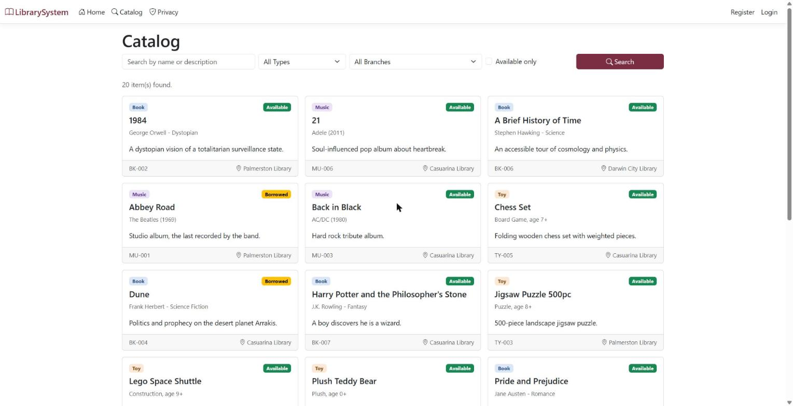

*Figure 1 — The catalogue, logged out, listing all twenty items*

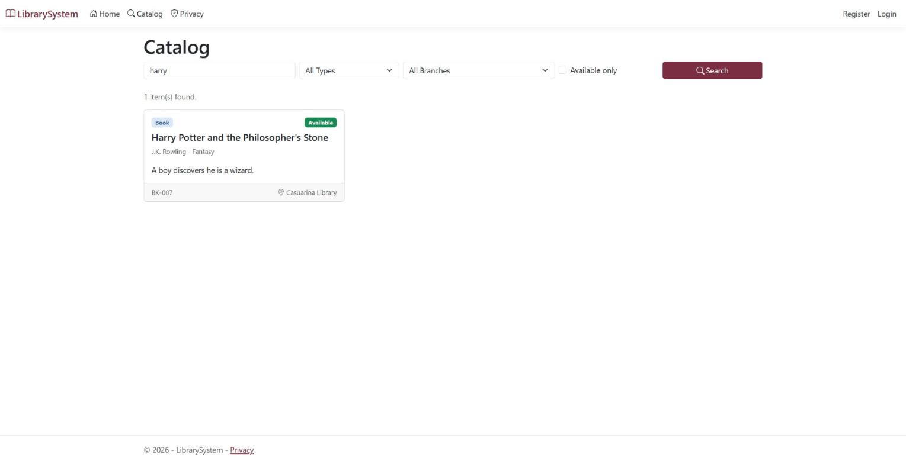

*Figure 2 — A search for "harry" narrowed to one result*

**Narrowing your results.** Use the boxes beside the search bar, then tap **Search** again:

- **Type** — only Books, only Music, or only Toys.

- **Branch** — only items currently held at one library (Figure 3).

- **Available only** — hides anything currently on loan.

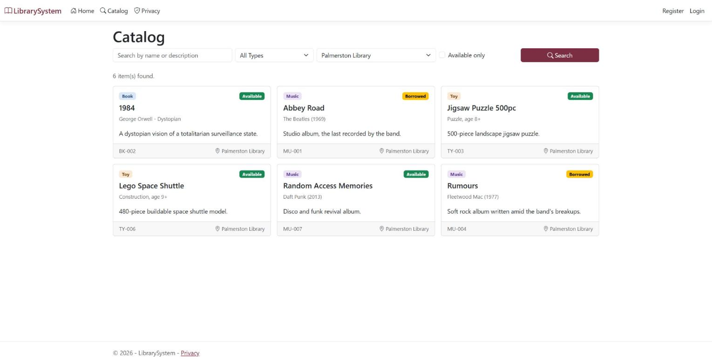

*Figure 3 — The branch filter showing only the six items held at Palmerston Library*

### 2. Reading your results

Each result is a card that tells you what the item is, whether you can have it, and where it is.

| On the card         | What it tells you                                                                                     |
|---------------------|-------------------------------------------------------------------------------------------------------|
| Coloured type label | Book, Music or Toy                                                                                    |
| Availability label  | **Available**, **Borrowed**, **Damaged** or **Destroyed**                                             |
| Title and details   | The title, the author, artist or toy type, and a short description                                    |
| Library code        | The item's unique code; quote it to staff at the front desk                                           |
| Branch              | Which library holds the item right now. Check this before visiting, as items move between branches    |
| "2 waiting" note    | Shown on unavailable items that others are queuing for. This is how many people would be ahead of you |

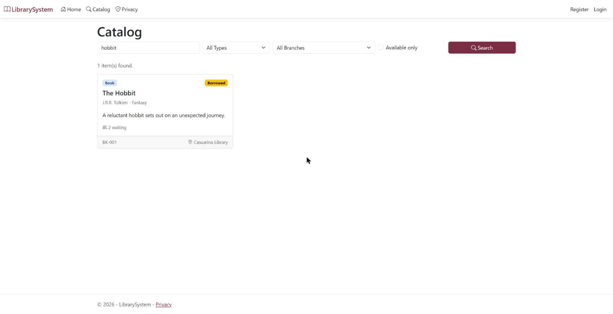

*Figure 4 — The Hobbit, Borrowed, with two people waiting*

**Wanting something that is on loan?** Join its waiting list by placing a hold at the self-service kiosk in any branch (section 3), or ask at the front desk.

### 3. Using the self-service kiosk

Every branch has a touchscreen kiosk. Searching needs nothing at all; you only need your library card number to place a hold, borrow, or check your account.

**Searching at the kiosk**

1.  On the welcome screen, tap **Search**. The screen shows which branch you are at (Figure 5).

2.  Type using the on-screen keyboard. No physical keyboard is needed.

3.  Tap **Search**. Results show the same details as the website: title, availability and which branch holds it (Figure 6).

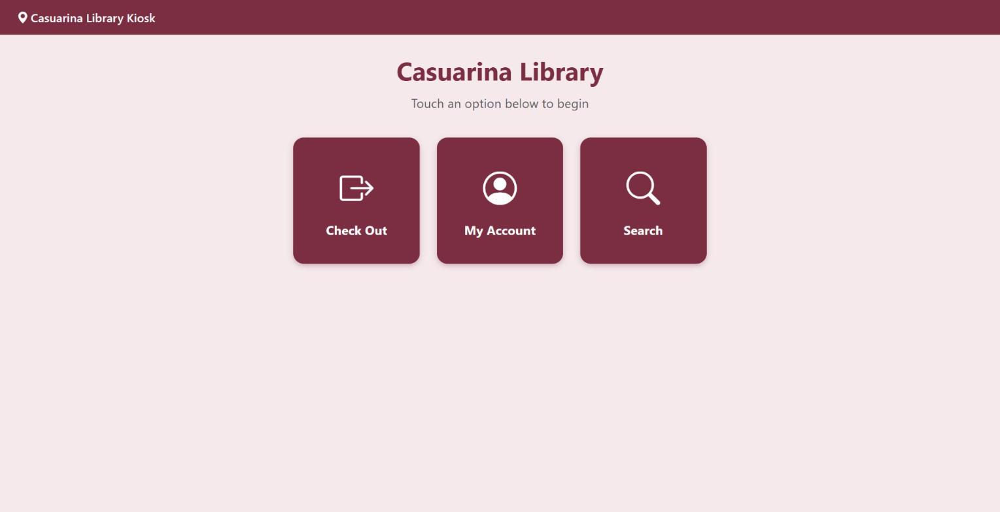

*Figure 5 — The kiosk welcome screen, naming the branch, with three large buttons*

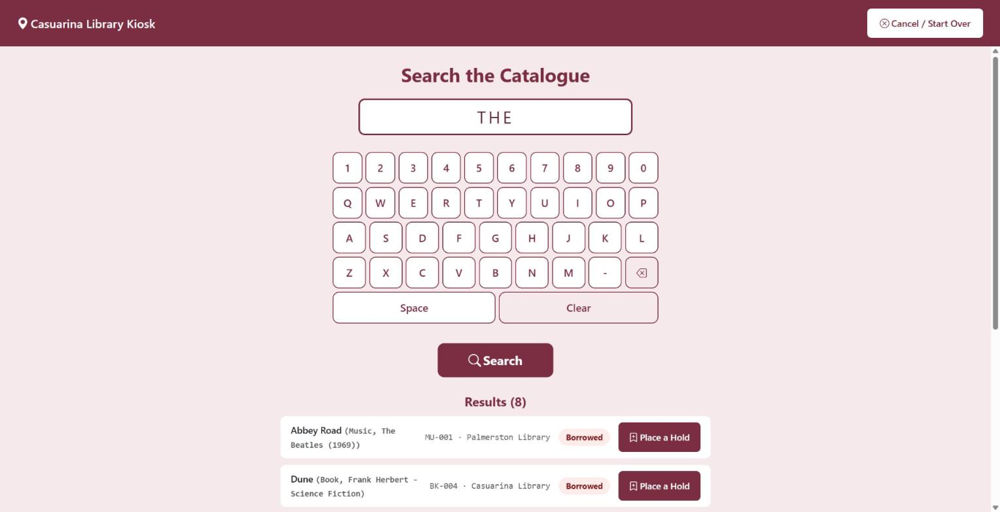

*Figure 6 — Kiosk search results, each with a Place a Hold button*

**Placing a hold on something that is on loan**

1.  Tap **Place a Hold** beside the item you want.

2.  Enter your library card number on the on-screen number pad.

3.  Tap **Confirm Hold**.

4.  The kiosk confirms the hold and shows your position in the queue (Figure 7).

If you try to check out an item that is already on loan, the kiosk offers **Place a Hold Instead**, which takes you straight to the same steps.

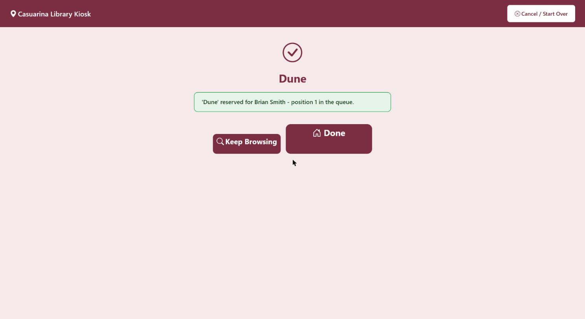

*Figure 7 — The kiosk confirming a hold and showing the patron's queue position*

When the item comes back you will be notified, and it is kept for you for three days.

**Good to know**

- Every screen has a **Cancel / Start Over** button in the top corner that returns to the welcome screen.

- Left untouched for about a minute, the kiosk goes back to the welcome screen by itself, so your card number is never left showing for the next person.

- The kiosk can also lend items to you and show your loans, fines and holds: tap **Check Out** or **My Account** on the welcome screen.

## Part 2 — For library staff

Each staff account sees only the menu links for its own job. This part walks through every task each account can do, one step at a time.

### Signing in and out

1.  Click **Login** in the top right of any page.

2.  Enter the account's email and password, then click **Log in**.

3.  The menu bar now shows the links for that role, and the header shows which branch this installation is.

4.  To finish, click **Logout** in the top right.

| Account   | Email                   | Password        |
|-----------|-------------------------|-----------------|
| Reception | `reception@library.com` | `Reception@123` |
| Manager   | `manager@library.com`   | `Manager@123`   |
| Admin     | `admin@library.com`     | `Admin@123`     |

Trying to open another role's page sends you to an Access Denied screen. That is the system working as intended.

### What each account can do

| Account   | Tasks                                                                                                                                                                                                               | Section |
|-----------|---------------------------------------------------------------------------------------------------------------------------------------------------------------------------------------------------------------------|---------|
| Reception | Add, edit and deactivate borrowers · lend items · return items and charge fines · view overdue loans · record fine payments · view a borrower's loan history · place and cancel holds · move items between branches | 4       |
| Manager   | View borrowing, item status and fine statistics · filter by branch · send due-date reminders · view sent notifications · run and download reports                                                                   | 5       |
| Admin     | Add, edit, view and delete books, music and toys · import items from a CSV file · import a book from the metadata lookup · open the API documentation                                                               | 6       |

**Finding an item's library code.** Most staff tasks start from an item's library code. If you don't have it, search for the item in the **Catalog** (section 1); the code is printed on each result card. The catalogue works whether or not you are signed in.

### 4. Reception

Reception runs the front desk for the branch this installation is set to. Sign in as `reception@library.com`.

#### 4.1 Add a new borrower

1.  Click **Borrowers** in the menu.

2.  Click **Add Borrower**.

3.  Fill in first name, last name, email, phone and address. Enter a phone number if the borrower wants text reminders; borrowers without one get reminders by email.

4.  Click **Create**. The borrower appears in the list and can borrow straight away.

#### 4.2 Find, view or edit a borrower

1.  Click **Borrowers**. The list shows every borrower with their contact details.

2.  Click **Details** to see a borrower's record, including their loan history: every item they have borrowed, when, when it came back and any fine.

3.  To change their details, click **Edit**, update the fields, and click **Save**.

#### 4.3 Remove a borrower

1.  Click **Borrowers**, then **Delete** beside the borrower.

2.  Check the details on the confirmation page and click **Delete** again.

A borrower who has ever borrowed something cannot be deleted, because their loan and fine records must be kept. The system blocks the delete and explains why. Instead, open **Edit**, untick **IsActive**, and click **Save**. The borrower list then shows them as Inactive: they stay on record but can no longer borrow.

#### 4.4 Lend an item

1.  Click **Borrow** in the menu.

2.  Type the item's **library code**.

3.  Choose the **borrower** from the list.

4.  Click **Borrow**.

5.  The screen confirms the loan and shows the **due date**, 14 days from today. The item's status changes to Borrowed everywhere, including the public catalogue, and the borrower is sent a confirmation.

The system refuses the loan, with a message saying why, if the item:

- is already on loan, damaged or destroyed;

- is held at a different branch from this one; or

- is being held for another borrower's reservation (section 4.7).

#### 4.5 Return an item and charge any fine

1.  Click **Return** in the menu.

2.  Type the item's **library code**.

3.  Under **Condition**, choose one of:

    - **Returned - no damage**

    - **Damaged** (shows the surcharge it adds)

    - **Lost / Destroyed** (shows the replacement fee it adds)

4.  Click **Return**.

5.  The screen shows the fine, if any. The fine is worked out automatically:

| Situation                           | Charge                                             |
|-------------------------------------|----------------------------------------------------|
| Returned on time, in good condition | No fine                                            |
| Returned late                       | \$0.50 per day overdue, up to a maximum of \$20.00 |
| Returned damaged                    | \$10.00, plus any late fee                         |
| Returned destroyed                  | \$50.00 replacement fee, plus any late fee         |

What happens to the item:

- **Returned - no damage** → it becomes Available. If someone is waiting for it, it is held for the first person in the queue instead, and they are notified.

- **Damaged** or **Lost / Destroyed** → its status changes to Damaged or Destroyed and it can no longer be lent.

- **Belongs to another branch** → a transfer back to its home branch is raised automatically (section 4.8).

#### 4.6 Check overdue loans and record fine payments (Overdue and Fines)

1.  Click **Overdue** in the menu to see every loan at this branch that is past its due date, with how many days overdue it is. The most overdue are highlighted.

2.  When a borrower pays a fine, click **Fines** in the menu.

3.  Find the borrower's unpaid fine and click **Mark Paid**.

4.  The fine is recorded as paid and moves from outstanding to paid in the Manager's fine statistics.

#### 4.7 Reservations (holds)

A hold puts a borrower in the queue for an item that is on loan or damaged. Available items are simply lent, not reserved.

**Place a hold for a borrower**

1.  Click **Reservations**, then **Place Reservation**.

2.  Type the item's **library code** and choose the **borrower**.

3.  Click **Reserve**. The borrower joins the end of the queue. A borrower can only hold the same item once.

**See who is waiting for an item**

1.  Click **Reservations**. The list shows every active hold, oldest first. Use the status dropdown to change which holds are shown; the list updates as soon as you pick.

2.  Click **View Queue** beside an item to see its queue in order, with the date each person joined (Figure 8).

3.  For an item with no row to click, for example when a patron phones in, click **Look Up Queue**, type the library code, and click **Look Up**.

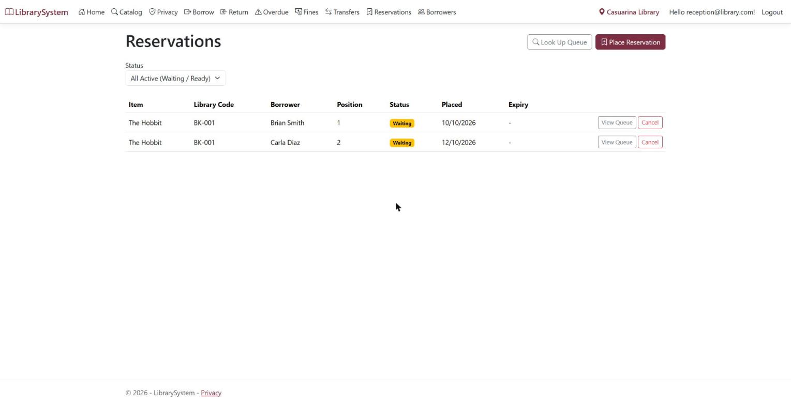

*Figure 8 — The two-person queue for The Hobbit, with positions and dates*

**What happens when a held item comes back.** The first person in the queue becomes **Ready** and is notified. The item is kept for them for three days. If they don't collect it in time, their hold expires and the next person becomes Ready. Holds close to expiry are highlighted.

**Lending a held item**

Lend it as normal (section 4.4). The system checks the hold for you:

- To anyone else, the loan is refused with a message that it is on hold for another borrower's reservation. The message deliberately does not say who (Figure 9).

- To the borrower it is held for, the loan goes through and the screen confirms **Reservation fulfilled** (Figure 10).

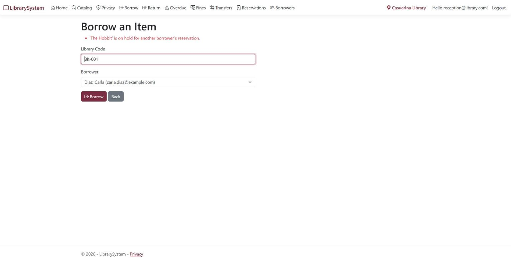

*Figure 9 — A loan refused because the item is held for another borrower*

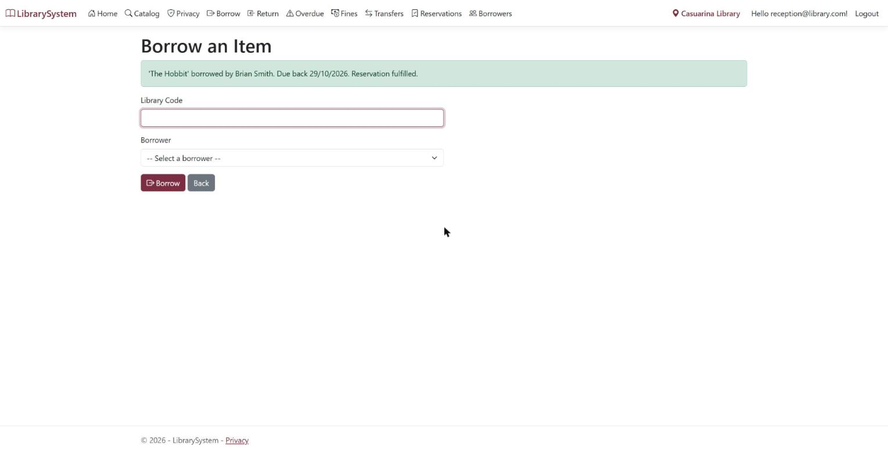

*Figure 10 — The same item lent to the right person: Reservation fulfilled*

**Cancel a hold**

1.  Click **Reservations** and find the hold.

2.  Click **Cancel**. Everyone behind that borrower moves up one place.

#### 4.8 Move an item to another branch (transfers)

A transfer goes through three stages: **Requested → In Transit → Completed**.

1.  Click **Transfers**, then **Raise Transfer**.

2.  Choose the **item**, the **branch it is going to**, and a short reason.

3.  Click **Raise Transfer**. The transfer appears as **Requested** (Figure 11).

4.  When the item physically leaves, the sending branch clicks **Mark In Transit**. Only the sending branch sees this button.

5.  When it arrives, the receiving branch clicks **Complete**. The item's location then updates everywhere, including the public catalogue.

6.  To stop a transfer that is no longer needed, click **Cancel**.

To see past transfers, pick a status from the dropdown at the top of the Transfers page; the list updates as soon as you pick (Figure 12).

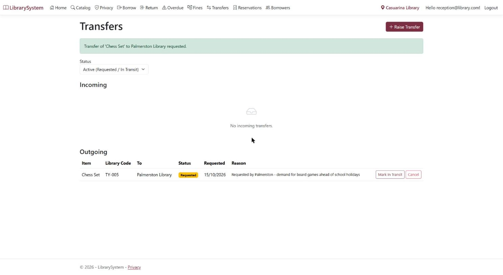

*Figure 11 — A new transfer of Chess Set to Palmerston, status Requested*

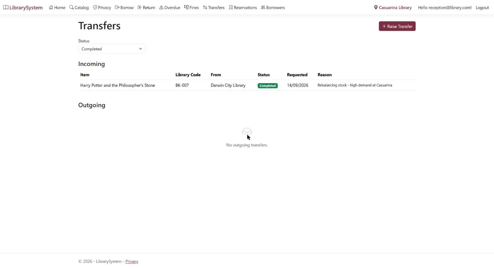

*Figure 12 — The Completed filter showing an earlier transfer of Harry Potter from Darwin City*

### 5. Manager

The Manager sees the whole library network and changes nothing in the collection. Sign in as `manager@library.com`.

#### 5.1 View the statistics dashboard

1.  Click **Dashboard** in the menu.

2.  The **Borrowing** tab opens first: loan counts, loans over time, the most borrowed items, and a table of overdue loans (Figure 13).

3.  Click the **Item Status** tab to see how many items are available, borrowed, damaged and destroyed, broken down by books, music and toys.

4.  Click the **Fines** tab to see total fines charged, paid and outstanding, and the average fine per loan.

5.  To see one library only, choose it in the **Branch** dropdown; the dashboard updates as soon as you pick. It shows all branches by default.

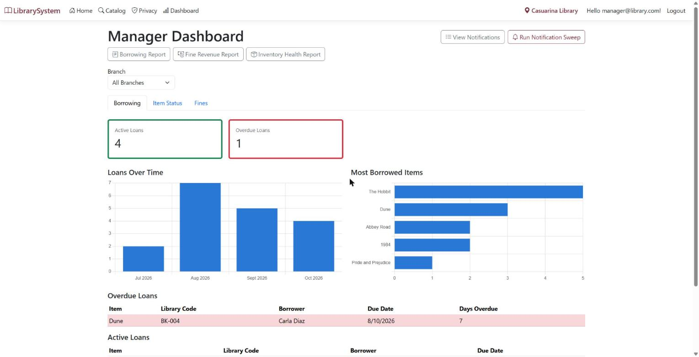

*Figure 13 — The Manager dashboard, Borrowing tab*

#### 5.2 Send due-date reminders

1.  Click **Dashboard** in the menu.

2.  Click **Run Notification Sweep**.

3.  The system finds loans due within three days and loans already overdue, and sends each borrower a reminder by SMS or email.

4.  A summary shows how many reminders were sent, how many borrowers had already been reminded today, and how many failed (Figure 14).

Running the sweep twice on the same day does not message anyone twice. The second run reports them as already notified.

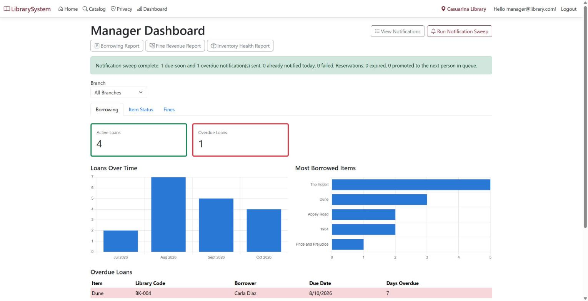

*Figure 14 — Sweep result: one due-soon and one overdue reminder sent, none failed*

#### 5.3 Check which notifications were sent

1.  Click **Dashboard** in the menu, then **View Notifications**. Every message the system has sent is listed, newest first, with its channel, type, status and the local time it went out (Figure 15).

2.  Narrow the list with the **channel**, **type**, **status** and **date** filters, then click **Filter**.

3.  Click **Details** on any row to read the exact message the borrower received.

Messages are sent for loans, due-soon and overdue reminders, fines, and reservations becoming ready. Email and SMS are simulated: nothing leaves the system, but every message is recorded exactly as it would be sent.

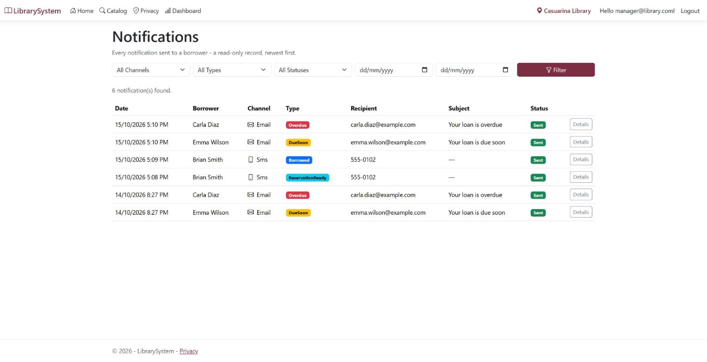

*Figure 15 — The notifications log, with email and SMS messages*

#### 5.4 Run and download a report

The **Dashboard** has a button for each of the three reports: **Borrowing Report**, **Fine Revenue Report** and **Inventory Health Report**.

| Report               | Shows                                                                                                   |
|----------------------|---------------------------------------------------------------------------------------------------------|
| Borrowing statistics | Loans per period, most borrowed items, active loans and overdue count, by branch                        |
| Fine revenue audit   | Fines charged, paid and outstanding, per borrower and per period, with totals                           |
| Inventory health     | Items by status and type at each branch, items away from their home branch, damaged and destroyed lists |

1.  On the **Dashboard**, click the button for the report you want.

2.  Set the **from** and **to** dates and, if needed, a single **branch**.

3.  Click **Apply** and check the results on screen.

4.  Click **Download CSV** for a spreadsheet that opens in Excel, or **Download PDF** for a printable copy (Figure 16). The file name includes the report name and date, and the file shows the filters you chose.

A report with no matching data still downloads, with headings and a "no data" line.

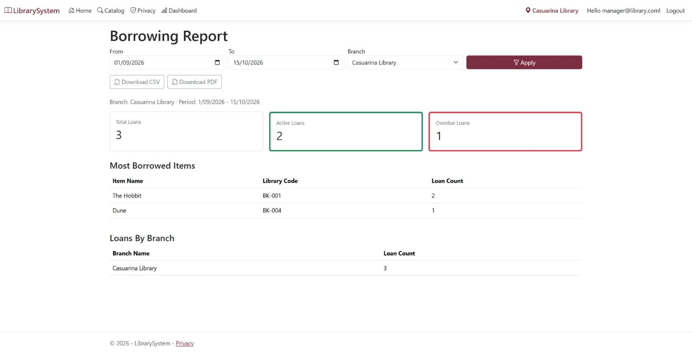

*Figure 16 — A borrowing report filtered by date range and branch, with CSV and PDF buttons*

### 6. Admin

The Admin looks after the collection itself: every book, music item and toy. Sign in as `admin@library.com`.

#### 6.1 Add a new item

1.  Click **Items** in the menu, then **Add Item**.

2.  Choose the **item type**: Book, Music or Toy. The form changes to show the fields for that type.

3.  Fill in the fields every item has:

    - **Name** and **Description**

    - **Library code**, which must be unique; the form refuses a code already in use

    - **Status**, normally Available for a new item

    - **Home branch**, the library the item belongs to

4.  Fill in the fields for the type:

| Type  | Extra fields              |
|-------|---------------------------|
| Book  | Author, Genre             |
| Music | Artist, Year              |
| Toy   | Toy type, Recommended age |

5.  Click **Create**. The item appears in the list and in the public catalogue, located at its home branch.

#### 6.2 Find, view or edit an item

1.  Click **Items**. Every item is listed with a type badge, its status and its branch.

2.  Click **Details** to see everything about one item.

3.  To change it, click **Edit**, update the fields, and click **Save**.

The item's **current branch** cannot be edited here. Physically moving an item has to go through a transfer (section 4.8), so every move is recorded. Its **status** can be changed here, for example to mark an item Damaged after an inspection.

#### 6.3 Delete an item

1.  Click **Items**, then **Delete** beside the item.

2.  Check the details and click **Delete** again to confirm.

An item that has ever been borrowed cannot be deleted, because its loan history must be kept. The system blocks the delete and explains why. Set its status to Destroyed instead if it is no longer in the collection.

#### 6.4 Import many items from a CSV file

1.  Click **Import** in the menu. The page opens on the **CSV Upload** tab.

2.  If you need a template, click **Download Sample CSV**. It shows the required columns: type, name, description, library code and home branch code, plus the fields for each type.

3.  Choose your CSV file and click **Upload & Preview**.

4.  Nothing is saved yet. A preview shows the rows ready to import and the rows with problems, each with the exact reason, such as a missing field, an unknown branch code or a library code already taken (Figure 17).

5.  Fix the problem rows in the file and upload again, or click **Confirm Import** to import only the valid rows.

6.  A summary reports how many items were created, skipped and rejected.

The import is all-or-nothing for the valid rows: if anything goes wrong part-way, no items are added.

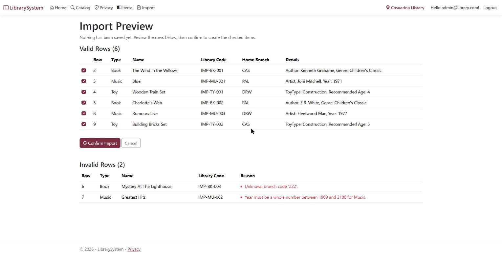

*Figure 17 — Import preview: six valid rows ready, two invalid with reasons*

#### 6.5 Import a book from the metadata lookup

1.  Click **Import** in the menu, then the **Search Metadata** tab.

2.  Search by **title** or **ISBN**.

3.  Click **Import** beside the matching result.

4.  On the next page, enter a **library code** and choose a **home branch**, then save. The book is added with its details already filled in.

The lookup uses a built-in sample catalogue, so it works without an internet connection.

#### 6.6 Open the API documentation

Other systems can read the catalogue through a read-only API.

1.  With the application running from Visual Studio, go to `/swagger`, for example `https://localhost:7009/swagger`. The page is only available in development mode, which is how Visual Studio runs it.

2.  Click **Authorize**, enter the API key (the development key is in `appsettings.json` under `ApiKey:Key`, and in the README), and click **Authorize** again.

3.  Open any endpoint, click **Try it out**, then **Execute** to see a live response (Figure 18).

The API can only read data; it cannot change anything. Without a valid key, every request is refused.

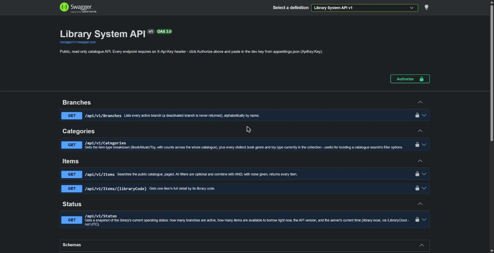

*Figure 18 — The API documentation listing the five read-only endpoints*
